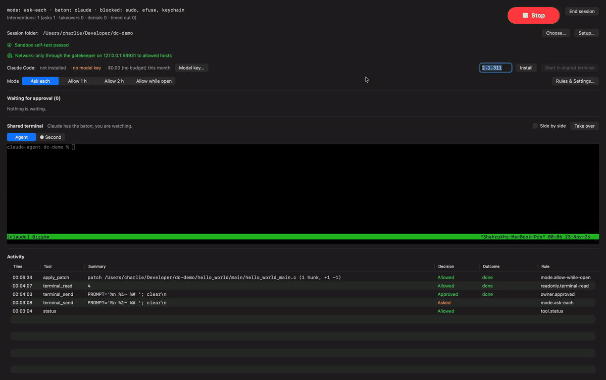
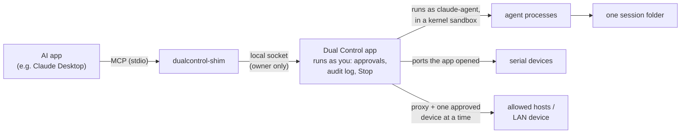

<p align="center">
  <picture>
    <source media="(prefers-color-scheme: dark)" srcset="assets/logo/mark-dark.svg">
    
  </picture>
</p>

<p align="center">
  <a href="https://github.com/shahrukhahmedkhan/dual-control/actions/workflows/ci.yml"></a>
  <a href="https://github.com/shahrukhahmedkhan/dual-control/actions/workflows/app.yml"></a>
  <a href="LICENSE"></a>
  
  
</p>

<p align="center"></p>

The demo: the assistant edits a hello-world, builds and flashes it to an ESP32-S3, reads the board's output, then tries `sudo`, which is always refused. Sped up in places; the full video is [here](assets/demo/dual-control-demo.mp4).

# Dual Control

Dual Control is a macOS app that lets an AI assistant (Claude Desktop, or any other MCP client) run commands, work with files and talk to hardware on your Mac, inside limits that macOS enforces.

Dual Control was built for embedded work: letting Claude build firmware, flash an ESP32, read the serial console, fix the code and try again. Giving an AI a normal shell on your Mac for that is a bad idea, so Dual Control gives it a separate account instead.

## How it works

The assistant talks to Dual Control over MCP. Dual Control runs everything the assistant asks for as a separate, unprivileged macOS user called `claude-agent`, inside a kernel sandbox that limits it to one folder you pick. That user can't read your home folder, your SSH keys or your keychain.



You decide how much it can do on its own. You can approve every command, allow everything for an hour or two, or allow everything while the app is open. Some things are always blocked: `sudo`, eFuse writes, and anything touching credentials or the keychain.

A few other details:

- Network access goes through a proxy with a list of allowed hosts. To reach a device on your LAN, the assistant has to ask, and you approve that one device. It can't scan the network.
- Serial ports are opened by the app, not by the assistant directly.
- ESP-IDF is installed into a folder the assistant can read but not change, and flashing only works with that copy.
- The assistant can commit to git, but it never sees your keys. The app pushes its `claude/*` branches as you, signs the commits, and can open a pull request. It never pushes to the default branch.
- If the assistant needs something only you should do, like logging in somewhere, it asks you to take over the shared terminal.
- Every command, decision and connection is logged in the app and in a hash-chained audit log.

The [threat model](docs/THREAT-MODEL.md) explains what this protects against and what it doesn't. Please read it before you trust Dual Control with anything important.

## Tools

| Tool | What it does |
| --- | --- |
| `status` | Shows the approval mode, who holds the terminal and what is always blocked. |
| `activity` | Returns the recent activity feed. |
| `run_command` | Runs one program (no shell) as the agent user, in the sandbox. |
| `job_status` | Shows a background job's state and the last lines of its output. |
| `job_cancel` | Stops one of the agent's background jobs. |
| `terminal_send` | Types into the shared terminal. |
| `terminal_read` | Reads what's in a shared terminal tab. |
| `request_takeover` | Asks you to take over the shared terminal. |
| `claude_code_start` | Starts Claude Code in the shared terminal, as the agent user. |
| `write_file` | Creates or replaces a file in the session folder. |
| `apply_patch` | Applies a unified diff to a file in the session folder. |
| `git_clone` | Clones an https repository into the session folder. |
| `git_init` | Creates a new git repository in the session folder. |
| `git_commit` | Commits as the agent, with hooks off. You push. |
| `git_sync` | Fetches the remote as you, then starts, rebases or fast-forwards a branch. |
| `net_allow_request` | Asks you to let the agent reach one device on your LAN. |
| `serial_list` | Lists serial ports with their USB ids. |
| `serial_open` | Opens a serial port. |
| `serial_read` | Returns what the device sent since the last read. |
| `serial_write` | Sends text or bytes to the device. |
| `serial_reset` | Resets the device into its firmware or bootloader. |
| `serial_close` | Closes a serial port. |
| `esp_idf_install` | Installs an ESP-IDF release into the protected toolchain folder. |

## Tests

`swift test` runs 718 tests in 8 test targets. Most of them are in `DualControlCoreTests` (465), which covers the pure core: the policy engine, approvals, the audit log, the sandbox profiles and the tool definitions. The other seven targets test the macOS parts: the sandbox (162), the socket between the shim and the app (35), the network proxy and model relay (18), the audit files and settings (16), serial ports (12), the terminal view (7) and the shim end to end (3).

Some tests need things that only a Mac has:

- The sandbox tests start real processes under `sandbox-exec` as your own user, so the kernel enforces the profiles they check.
- Three shared-terminal tests drive a real tmux. Without tmux they're skipped, except in CI, where a missing tmux makes them fail.
- Two tests run commands as the real `claude-agent` user. They only run when `DC_REAL_AGENT_ROOT` points at a session folder, and are skipped otherwise.
- Two tests build Swift packages inside the sandbox. On a CI runner they slow down the timing tests next to them, so CI skips them unless `DC_BUILD_TESTS=1` is set.

The macOS-only targets compile to nothing on Linux, so a Linux `swift test` runs only the 465 core tests.

There are two workflows:

- [CI](.github/workflows/ci.yml), on every push to main and every pull request: swift-format lint and `swift test` in a Linux `swift:6.2` container, and a gitleaks scan of the full history.
- [macOS](.github/workflows/app.yml), on every push to main and on pull requests that touch the app, the sources or the tests: an unsigned Debug build of the app, and the full `swift test` on macOS 15 with tmux installed.

## Install

There are no signed builds yet, so you build it from source.

You need:

- macOS 14 or newer and Xcode 26 or newer (Swift 6.2)
- tmux from Homebrew (`brew install tmux`) for the shared terminal
- an admin account, once, to create the `claude-agent` user and add one sudoers line. The app's Setup sheet shows the commands and checks them. It never runs them itself.
- Claude Desktop or another MCP client that can start a local stdio server
- for ESP-IDF, Python 3.10 or newer from Homebrew (`brew install python@3.12`)

```sh
git clone https://github.com/shahrukhahmedkhan/dual-control.git
cd dual-control
swift build                    # core + shim
swift test                     # some tests need tmux and use the real kernel sandbox
open App/DualControl.xcodeproj # build and run the app
```

Then follow [docs/USING.md](docs/USING.md) to create the agent user, pick a session folder and connect your MCP client. There are also guides for [Claude Desktop](docs/claude-desktop.md) and [ESP-IDF](docs/esp-idf.md), and more detail on the security setup in [docs/security.md](docs/security.md).

## Limitations

- macOS only, and one owner per Mac.
- The sandbox uses Seatbelt profiles through `sandbox-exec`, which Apple has deprecated. It works today, but it's the main reason for the planned move to VMs (see below). [docs/DESIGN.md](docs/DESIGN.md) explains why it was chosen, what happens if it stops working, and how a move to VMs could look.
- One session folder at a time, under `~/Developer`.
- Files the assistant writes are normal files. Read them before you run them yourself.
- The assistant can't discover devices on your network. You have to tell it the address.
- Early software: used daily on real hardware, with one user so far.

## Plans

- Let the assistant see what you did during a takeover, if you choose to share it.
- Device discovery done by the app, so you can pick a device from a list instead of looking up its IP.
- Support for other agents, not just Claude.
- A VM per project folder (Virtualization.framework), so the assistant can install and run whole toolchains without touching the host at all. The tradeoffs are in [docs/DESIGN.md](docs/DESIGN.md).

## Security

Please report security problems privately, as described in [SECURITY.md](SECURITY.md). Contributor notes are in [AGENTS.md](AGENTS.md). Install the hooks once with `pre-commit install` (gitleaks and swift-format lint).

## License

Apache-2.0 © 2026 Shahrukh Ahmed Khan. See [LICENSE](LICENSE), and [NOTICE](NOTICE) for third-party licenses.
