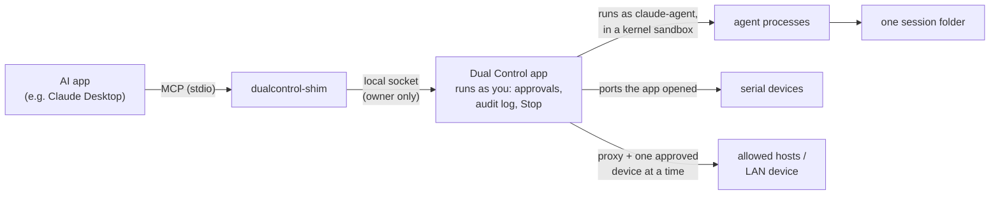

<p align="center">
  <picture>
    <source media="(prefers-color-scheme: dark)" srcset="assets/logo/mark-dark.svg">
    
  </picture>
</p>

# Dual Control

**Dual Control gives the AI on your Mac real hands — your terminal, your toolchains, your hardware — while you keep
the keys.**

<!-- TODO v1.0.1: demo GIF -->

An AI assistant asked to "flash this board and check the serial output" usually stops at the edge of the chat.
Dual Control lets it carry on: it builds the firmware, flashes the ESP32, reads the console, commits the fix and
opens a pull request — and the owner of the Mac only steps in when something genuinely new is about to happen.

The first real-world test: Claude found a network printer (with one owner takeover), asked which formats it
speaks, rendered a page and printed it — from inside a sandbox that cannot see the rest of the network.

## What it does

- **Safe access.** Everything the AI runs, runs as a separate, unprivileged macOS user inside a kernel sandbox,
  scoped to one folder you choose. The limits are enforced by macOS, not by the model's good behaviour.
- **Whole tasks, fewer interruptions.** Build, flash, test, commit, open a pull request, print: the AI works through
  the whole job. You step in at the real boundaries — a new device on the network, a login, a push — with one
  click or a takeover of the shared terminal, and every step is logged.
- **Bring your own harness** (next). Any agent, not just one vendor's, behind the same gate.

## How the trust model works

Read the full [threat model](docs/THREAT-MODEL.md) first — it explains what Dual Control defends against, and what
it doesn't.



- **A separate, unprivileged user.** Your home, keys, keychain and other projects are outside the agent's world.
- **You hold the boundaries.** New LAN devices, logins and anything owner-only go through you: one click to approve
  a device, or a *takeover* of the shared terminal for steps only you should do.
- **Real hardware, safely.** Serial ports opened by the app, flashing from an owner-owned toolchain the agent can
  read but never change, and per-device network forwarders (no scanning, no broadcast).
- **Git without your keys.** The agent commits; the app pushes `claude/*` branches as you, re-signed with your key,
  and can open the pull request. It never pushes the default branch and never force-pushes anything but its own
  rebased branches.
- **Always blocked:** `sudo`, eFuse writes, credentials and the keychain.
- **Everything is logged.** Every call, decision and connection appears in the activity feed and a hash-chained
  audit log.

## Tools (23)

| Tool | What it does |
| --- | --- |
| `status` | Shows the approval mode, who holds the terminal and what is always blocked. |
| `activity` | Returns the recent activity feed, as the owner sees it. |
| `run_command` | Runs one program from an argument vector (no shell) as the agent user, in the sandbox. |
| `job_status` | Shows a background job's state and the last lines of its output. |
| `job_cancel` | Withdraws or stops one of the agent's background jobs. |
| `terminal_send` | Types into the shared terminal, which runs as the agent user. |
| `terminal_read` | Reads the recent contents of a shared terminal tab. |
| `request_takeover` | Asks the owner to take over the shared terminal, e.g. to type a password. |
| `claude_code_start` | Starts the owner's pinned Claude Code in the shared terminal, as the agent user. |
| `write_file` | Creates or replaces one file in the session folder. |
| `apply_patch` | Applies a unified diff to one file in the session folder. |
| `git_clone` | Clones an https repository into the session folder. |
| `git_init` | Makes a folder in the session folder a new git repository. |
| `git_commit` | Commits in a repository, as the agent, hooks off; the owner pushes. |
| `git_sync` | Fetches the remote as the owner, then starts, rebases or fast-forwards a branch. |
| `net_allow_request` | Asks the owner to let the agent's programs reach one device on the local network. |
| `serial_list` | Lists serial ports with their USB vendor/product ids, without opening any. |
| `serial_open` | Opens a serial port exclusively; the app buffers what the device sends. |
| `serial_read` | Returns what the device sent since the last read. |
| `serial_write` | Sends text or hex bytes to the device. |
| `serial_reset` | Resets the device into its firmware or bootloader with DTR/RTS. |
| `serial_close` | Closes a serial session and frees its port. |
| `esp_idf_install` | Builds an ESP-IDF release into the app's owner-owned toolchain folder. |

## Install from source

Requirements:

- macOS 14 or newer, Xcode 26 or newer (Swift 6.2).
- Homebrew's tmux (`brew install tmux`) for the shared terminal.
- An admin account once, to create the `claude-agent` user and one sudoers line (the app's **Setup…** sheet shows
  the commands and checks them; the app never runs them itself).
- Claude Desktop, or another MCP client that starts a local stdio server.
- For ESP-IDF: Python 3.10 or newer from Homebrew (`brew install python@3.12`).

```sh
git clone https://github.com/shahrukhahmedkhan/dual-control.git
cd dual-control
swift build                    # core + shim
swift test                     # all tests (some need tmux and run against the real kernel sandbox)
open App/DualControl.xcodeproj # build and run the app
```

Then follow [docs/USING.md](docs/USING.md) to create the agent user, choose a session folder and connect your AI
app ([Claude Desktop guide](docs/claude-desktop.md), [ESP-IDF](docs/esp-idf.md)). Security details:
[docs/security.md](docs/security.md).

## Limits

- macOS only, one owner per Mac.
- The sandbox uses Seatbelt profiles via `sandbox-exec`, which Apple has deprecated. It works today; the long-term
  plan is a VM per folder (see the roadmap).
- One session folder at a time, under `~/Developer`.
- Files the AI writes are plain files: review them before you run them as yourself.
- Network discovery is deliberately not available to the agent; device discovery by the owner is on the roadmap.
- Early software: built and used daily by one person on real hardware. No releases or signed builds yet. Expect
  sharp edges.

## Roadmap

- **Next:** share takeover output with the agent on hand-back; owner-side device discovery (Bonjour) with
  one-click approval.
- **Bring your own harness:** any agent behind the same gate.
- **A VM per folder** (Virtualization.framework): the AI builds whole toolchains, runs and tests them, and reaches
  real hardware — with hardwired security and fail-safes.
- **One supervised gateway** for all kinds of tasks, instead of a custom MCP server for each one.

## Security

Please report vulnerabilities privately — see [SECURITY.md](SECURITY.md). Contributing: [AGENTS.md](AGENTS.md);
install the hooks once with `pre-commit install` (gitleaks + swift-format lint).

## Licence

See [LICENSE](LICENSE), and [NOTICE](NOTICE) for third-party licences.
